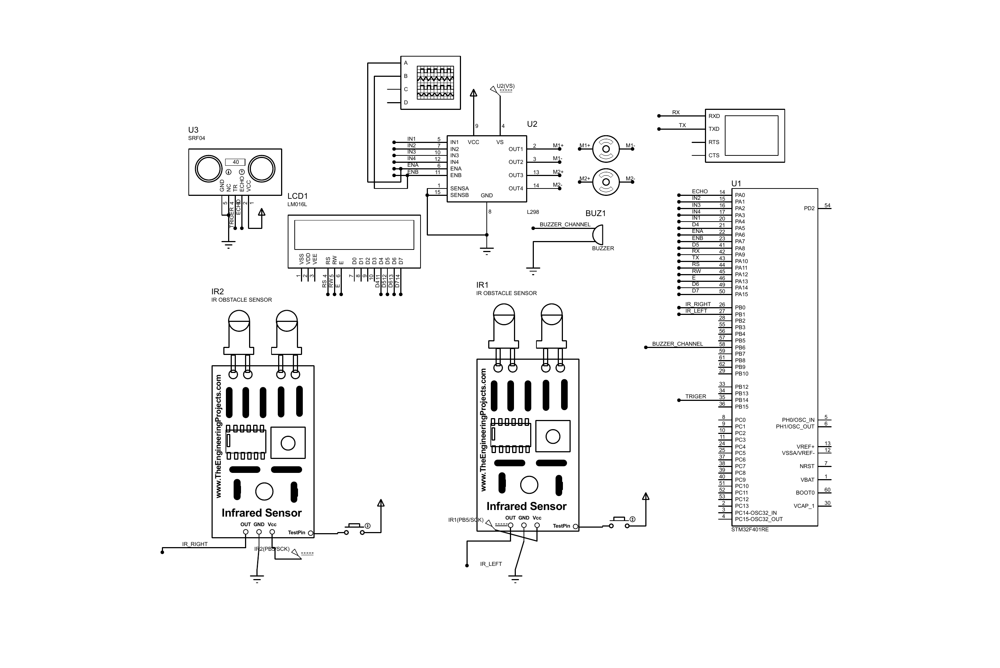

# STM32 ADAS-Inspired Vehicle Simulation

> A simulation-only NTI capstone exploring obstacle-aware speed states, IR-based line tracking, motor control, driver warnings, and UART telemetry on an STM32F401CC.




## Project scope

This project was developed in 2023 by a team of approximately five trainees as an NTI embedded-systems capstone. It represents the control electronics of a small educational vehicle in Proteus; no physical vehicle was built or validated.

The team wrote the project firmware, including register-level peripheral drivers and application logic. Individual module ownership was not recorded at the time, so this repository presents the implementation as **team work** rather than assigning unsupported authorship claims.

The project is inspired by ADAS concepts, but it is not an automotive system, a safety-certified controller, or evidence of road-ready functionality.

## Demonstrated behavior

| Function | Evidence in repository | Scope |
| --- | --- | --- |
| Obstacle-aware state transitions | HC-SR04 input-capture driver and state machine | Simulated |
| Three speed states | Idle, low-speed, and high-speed application modes | Simulated |
| IR-based line correction | Two digital IR inputs and differential motor commands | Simulated |
| Motor speed and direction | PWM and GPIO control for an L298-style driver | Simulated |
| Operator feedback | LCD messages and buzzer states | Simulated |
| Telemetry | Speed and distance frame sent through UART | Source implementation |

## Control logic

- Distance above `20 cm`: transition toward high-speed mode.
- Distance from `10 cm` to `20 cm`: transition toward low-speed mode.
- Distance below `10 cm`: transition to the stopped/idle state.
- Two IR readings select forward, left-correction, right-correction, or stop behavior.

These thresholds are configurable in `firmware/stm32_f401/Inc/SMode_Config.h`.

## Architecture

```text
Application
  main + initialization + driving-state machine
        |
Services / component drivers
  HC-SR04 + IR + motors + buzzer + LCD + UART
        |
MCAL
  RCC + GPIO + SysTick + timers + NVIC
        |
STM32F401CC register map
```

See [the architecture notes](docs/ARCHITECTURE.md) for the module and execution-flow breakdown.

## Repository structure

```text
firmware/stm32_f401/
  Inc/                    headers and configuration
  Src/                    application and driver implementations
  Startup/                STM32 startup assembly
  .project / .cproject    recovered STM32CubeIDE configuration
simulation/proteus/
  adas_simulation.pdsprj  Proteus project
  schematic.pdf           exported circuit schematic
  InfraredSensorsTEP.HEX  archived simulation binary
docs/
  ARCHITECTURE.md
  SETUP.md
  VALIDATION.md
  proteus-schematic.png
```

## Reproduce the archived project

Follow [the setup guide](docs/SETUP.md). The source and project configuration have been recovered, but the 2026 repository cleanup has not yet been rebuilt in a fresh STM32CubeIDE installation. That remaining verification is tracked in [VALIDATION.md](docs/VALIDATION.md).

## Evidence and limitations

Available:

- C source and headers
- STM32 startup and linker files
- STM32CubeIDE project metadata
- Proteus project and exported schematic
- archived simulation HEX file

Not available:

- physical prototype photographs or video
- hardware measurements
- formal timing, braking-distance, or safety tests
- original per-person task allocation

## Repository maintenance

In 2026 the archive was reorganized for reproducibility and scholarship review. This cleanup adds missing project metadata, repairs the UART frame construction, restores a missing public interface header, and updates documentation. These maintenance changes are separate from the original 2023 capstone work.

## Team and publication note

This is a five-person team artifact published with team permission. The repository intentionally avoids claiming that one member authored every module.

## License

MIT - see [LICENSE](LICENSE).
